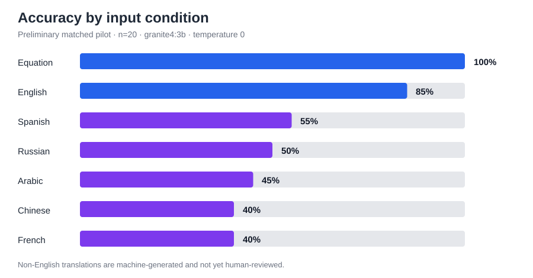

# Preliminary 20-problem multilingual MCP-agent pilot

## Question

How does the same tool-using arithmetic agent perform when the same SVAMP problems are presented as canonical equations, English word problems, or word problems in the six official UN languages?

## Controlled setup

- Dataset: corrected SVAMP data reused from the ADF repository.
- Sample: 20 records selected without replacement using seed `798`.
- Architecture: one LLM agent with the same four MCP tools (`add`, `subtract`, `multiply`, and `divide`).
- Model: local `granite4:3b` through Ollama.
- Temperature: `0`.
- Scoring: the unchanged ADF strict numeric-answer scorer.
- Held constant: model, temperature, tools, maximum-step policy, scorer, sample size, and ordered problem IDs.
- Changed variable: equation input versus the language of the SVAMP body and question.

All seven result files have the same ordered problem-ID SHA-256 value:
`a4d31948f6cb64efdba5a31b274a00073b86d9656d5483e8ef497faa9caa2ad0`
(IDs joined with newline characters before hashing).

## Results

| Input | Correct | Accuracy | Wrong answer | Format failure | API error | Tool error | Mean latency (ms) |
| --- | ---: | ---: | ---: | ---: | ---: | ---: | ---: |
| Canonical equation | 20/20 | 100% | 0 | 0 | 0 | 0 | 1,352 |
| English word problem | 17/20 | 85% | 3 | 0 | 0 | 0 | 2,265 |
| Spanish word problem | 11/20 | 55% | 8 | 1 | 0 | 0 | 2,391 |
| Russian word problem | 10/20 | 50% | 10 | 0 | 0 | 0 | 2,337 |
| Arabic word problem | 9/20 | 45% | 11 | 0 | 0 | 0 | 2,510 |
| Chinese word problem | 8/20 | 40% | 11 | 1 | 0 | 0 | 2,325 |
| French word problem | 8/20 | 40% | 11 | 1 | 0 | 0 | 2,298 |



## Interpretation

The equation condition removes the need to infer an operation from language, and the agent answered all 20 cases correctly. Accuracy fell by 15 percentage points when the same problems were supplied as English text. This isolates an additional language-understanding burden even though the arithmetic tools were unchanged.

The translated-language conditions scored below English in this pilot. There were no API or MCP tool errors, so the observed failures occurred before or after successful tool execution: interpreting the problem, choosing the operation, supplying arguments, or formatting the answer.

These results are preliminary and must not be used to rank languages or claim general multilingual ability. Twenty records are a small sample, and the five non-English files were generated with NLLB while preserving the original numeric literals but have not received human linguistic review. Translation quality and model language ability are therefore confounded.

## GAICo note

The meeting notes propose GAICo for standardized comparison. This pilot retains the ADF exact numeric scorer as the primary metric because the target output is a number and a near-text match can still be mathematically wrong. A later GAICo integration can standardize reporting or compare explanatory text, but this pilot does not claim a GAICo score.

## Reproduce

Start the reused MCP server:

```bash
cd upstream_adf/code
../../.venv/bin/python mcp_server.py
```

From the repository root, run the equation baseline and repeat the language command for `en ar zh fr ru es`:

```bash
.venv/bin/python extension/run_experiment.py \
  --condition author_equation --provider ollama --model granite4:3b \
  --temperature 0 --limit 20 --sample random --seed 798 \
  --output results/pilot_20_seed798_granite_agent/equation.json

.venv/bin/python extension/run_experiment.py \
  --condition language_extension --provider ollama --model granite4:3b \
  --temperature 0 --limit 20 --sample random --seed 798 --language es \
  --allow-machine-generated-translations \
  --output results/pilot_20_seed798_granite_agent/word_es.json
```

The directory contains the seven raw result files with per-problem outcomes and tool-use traces. `multilingual_only.md` is generated by `extension/compare_multilingual.py`.
